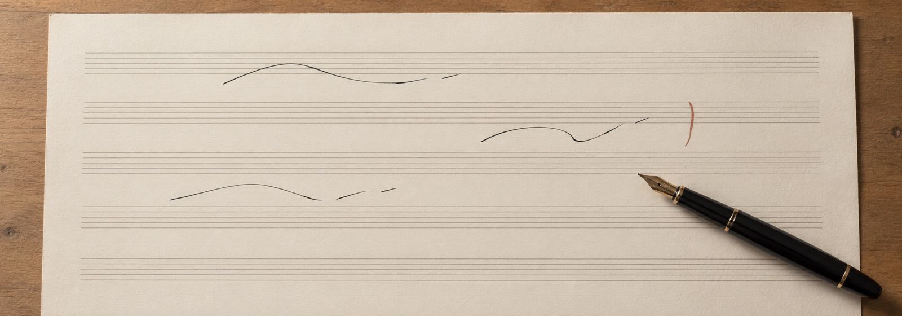
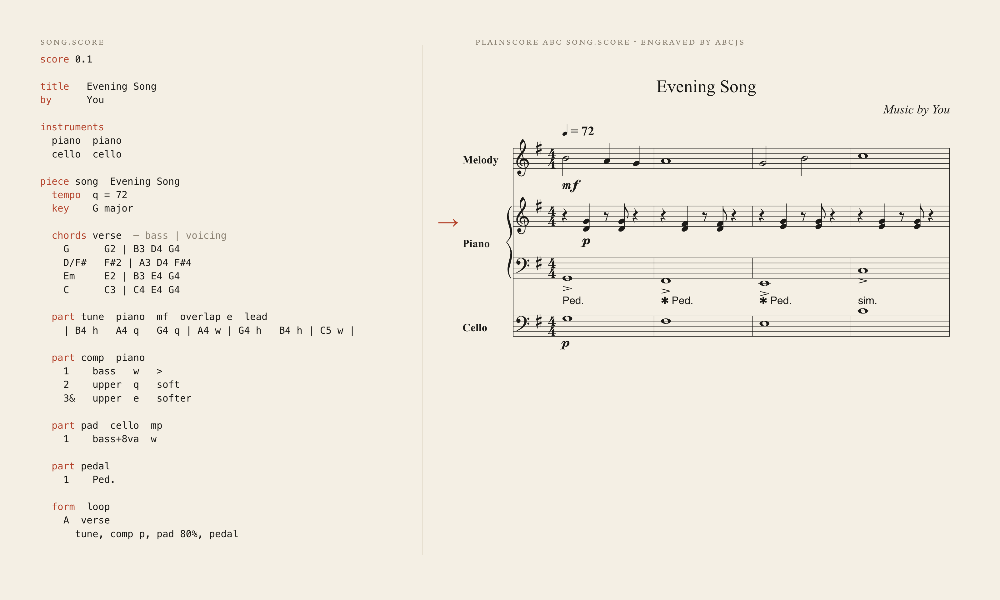
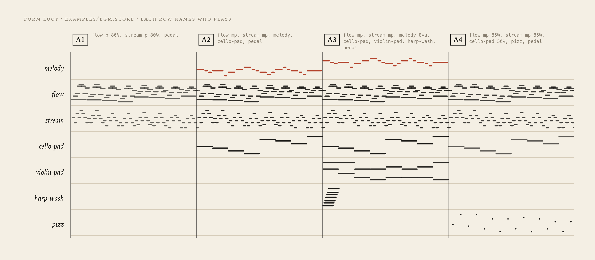
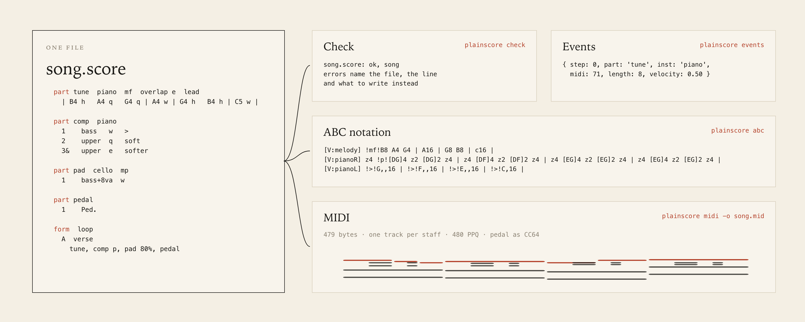

# plainscore

> A plain-text music score. One `.score` file reads like a composer's sketch, edits line by line, and compiles to ABC notation, MIDI and timed note events. TypeScript, no runtime dependencies.





<details>
<summary><code>song.score</code> as text</summary>

```
score 0.1

title   Evening Song
by      You

instruments
  piano  piano
  cello  cello

piece song  Evening Song
  tempo  q = 72
  key    G major

  chords verse  — bass | voicing
    G      G2 | B3 D4 G4
    D/F#   F#2 | A3 D4 F#4
    Em     E2 | B3 E4 G4
    C      C3 | C4 E4 G4

  part tune  piano  mf  overlap e  lead
    | B4 h   A4 q   G4 q | A4 w | G4 h   B4 h | C5 w |

  part comp  piano
    1    bass   w   >
    2    upper  q   soft
    3&   upper  e   softer

  part pad  cello  mp
    1    bass+8va  w

  part pedal
    1    Ped.

  form  loop
    A  verse
      tune, comp p, pad 80%, pedal
```

</details>





- Install: `pnpm add -D plainscore` (Node 20+).
- CLI: `plainscore check|abc|midi|events|legend <file> [--piece id] [--variant v] [--seed n] [--passes n] [-o out.mid]`.
- API: `render(parseScore(text, file), piece, { variant, seed })`, then `toAbc(r)` or `toMidi(r)`.
- Staves follow `instruments`. The family (`piano harp violins violas cello bass flute oboe clarinet bassoon horn trumpet voice synth`) sets clef, MIDI program and pedal. A piano `lead` gets a Melody staff; `pizz.` gets its own staff.
- Not in 0.1: meters other than 4/4, tuplets, ties across barlines, tempo changes, hairpins, repeats with endings, imports, percussion.

## Docs

- [Grammar](docs/grammar.md): every keyword of score 0.1, with examples
- [Legend](src/legend.ts): the legend a score can carry so readers need no docs; `plainscore legend`
- [llms.txt](llms.txt): this index, for agents

## Examples

- [bgm.score](examples/bgm.score): two pieces with variants, loop, ad lib. and mix
- [road.score](examples/road.score): a full single for piano, harp and strings

## API

- [plainscore](src/index.ts): `parseScore`, `render`, `checkScore`, `layout`, `seeded`
- [plainscore/abc](src/abc/index.ts): `toAbc(rendering)`, ABC for abcjs 6
- [plainscore/midi](src/midi.ts): `toMidi(rendering)`, SMF type 1, 480 PPQ, pedal as CC64
- [plainscore/legend](src/legend.ts): `LEGEND`

## Optional

- [Fixtures](fixtures): expected ABC, MIDI and events for the examples; run `pnpm test -u` after an intended change
- [package.json](package.json): `pnpm test`, `pnpm typecheck`, `pnpm build`
- [License](LICENSE): MIT
